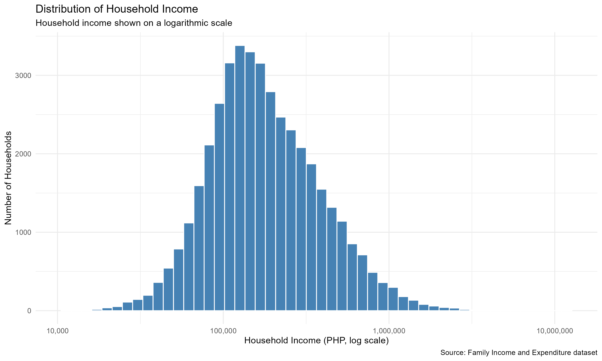
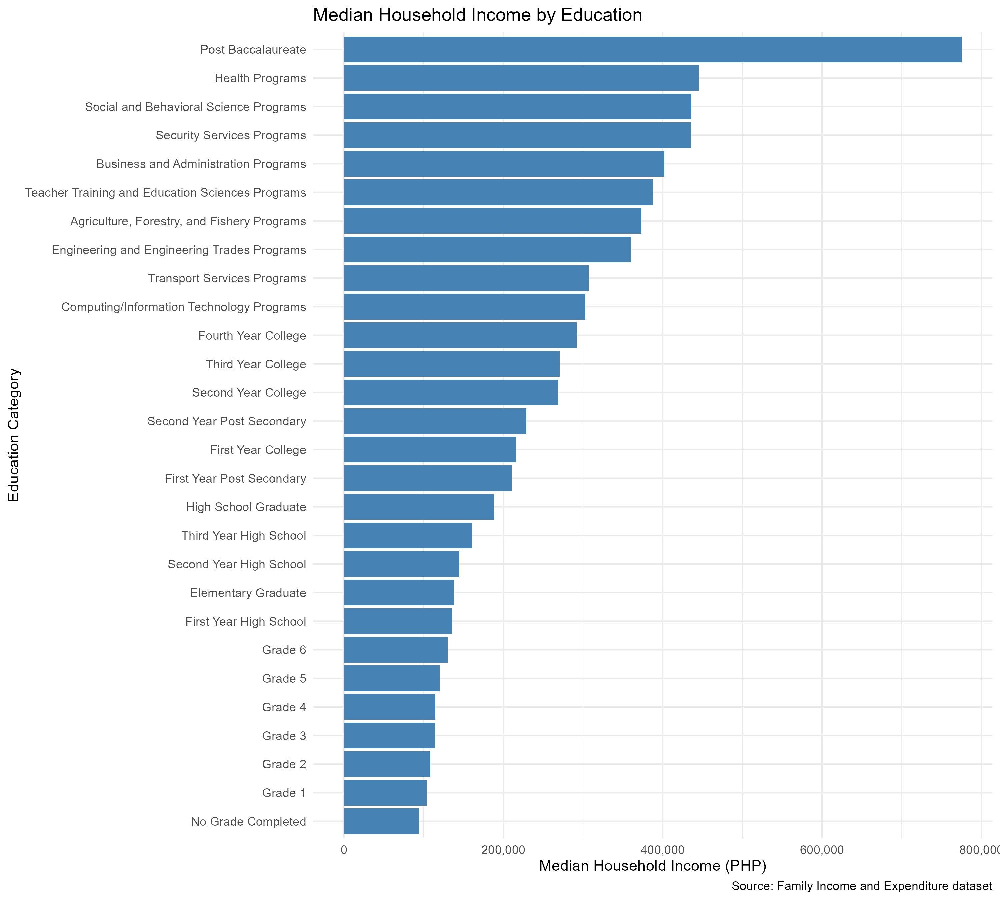

# Family Income Analysis

## Project Overview
This project explores household income using the Family Income and Expenditure dataset from the Philippines. I used R to inspect and clean the data, summarise income, and examine how median household income differs across education categories.

## Tools Used
- R
- tidyverse
- ggplot2
- scales

## Project Objectives
- Understand the distribution of household income.
- Check data quality and missing values.
- Compare median household income across education categories.
- Communicate findings through visualisations.

## Key Findings
- The dataset contains 41,544 households and 60 variables.
- Household income is right-skewed, meaning a smaller number of households have much higher incomes than most households.
- Median household income varies across education categories.
- The dataset contains missing occupation and class-of-worker values associated with households whose heads reported having no job or business.

## Visualisations

### Household Income Distribution

### Median Income by Education Category

## Data Quality
The dataset contains no exact duplicate rows. Missing occupation and class-of-worker values were retained because they appear to be associated with employment status rather than being missing at random.

## Limitations
- The analysis describes associations and does not establish causation.
- Education categories include both levels of attainment and fields of study.
- The findings describe the households represented in this dataset and may not generalise to other populations.

## Project Structure
- `data/raw/` — Original dataset
- `scripts/analysis.R` — R analysis code
- `plots/` — Generated charts

## Conclusion
This project demonstrates basic data cleaning, descriptive statistics, grouping and summarisation, and data visualisation in R.
